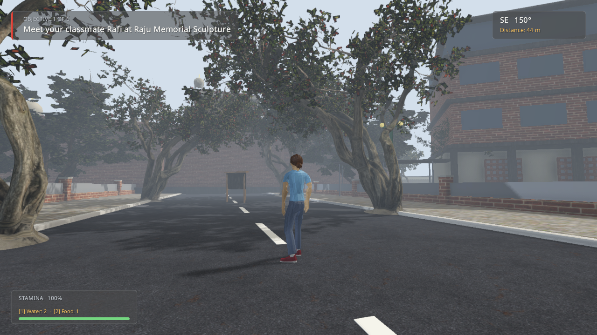
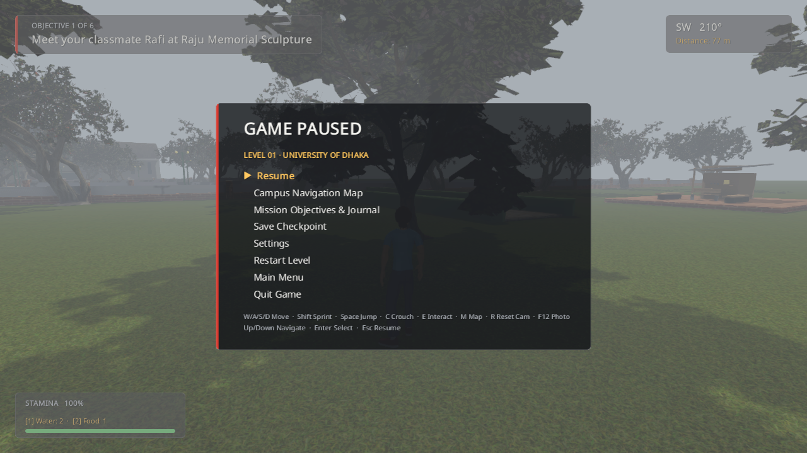
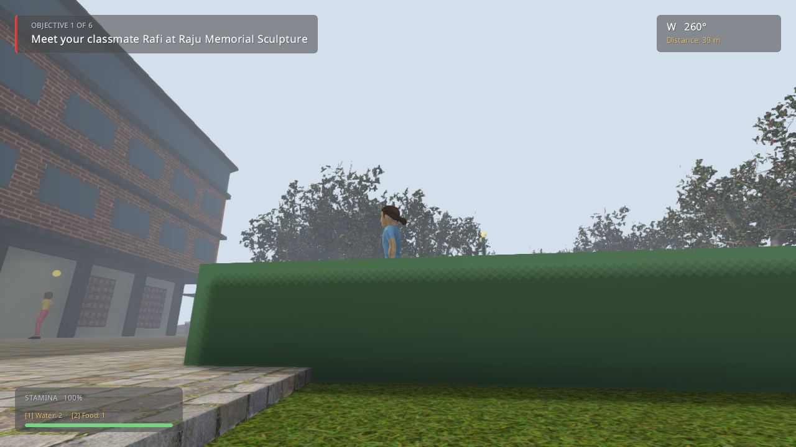
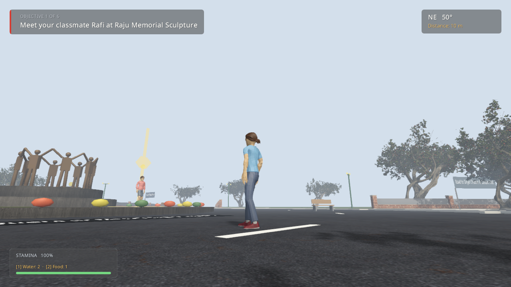
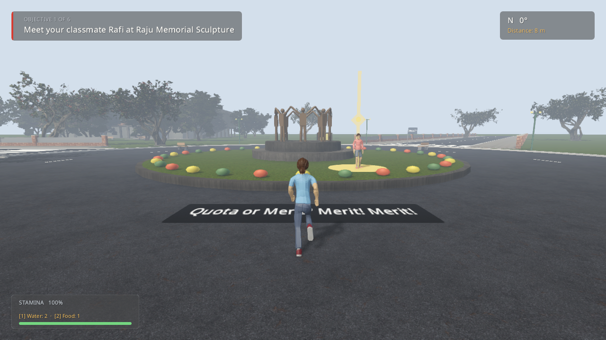

# Project July 2024 (প্রজেক্ট জুলাই ২০২৪)

A historically grounded, third-person 3D action-adventure and architectural reconstruction set during the historic July–August 2024 student movement in Bangladesh. Built with **jMonkeyEngine 3.7 (Java 17)** and targeting 60 FPS on modern systems including Apple Silicon (macOS) and Windows x64.

---

## 🏛️ Campus Architecture Showcase

### Curzon Hall & Curzon Freshwater Pond (কার্জন হল ও কার্জন পুকুর)
> *Indo-Saracenic architectural masterpiece featuring ornate red-brick facades, Mughal chhatri kiosks, multicusped archways, front freshwater pond with stepped brick ghats, water reflection, and botanical garden grounds.*



---

### Campus Landmarks & Architectural Heritage

| Landmark | In-Engine Reconstruction Preview | Description |
|:---|:---:|:---|
| **Central Library & Hakim Chattar**<br>*(ঢাকা বিশ্ববিদ্যালয় কেন্দ্রীয় গ্রন্থাগার ও হাকিম চত্বর)* |  | Muzharul Islam's iconic modernist architecture: reinforced concrete pilotis colonnade, external architectural ramp, vertical brise-soleil sun louvers, and the lively Hakim Chattar tea stall beneath the sacred banyan tree. |
| **Teacher-Student Centre (TSC)**<br>*(ছাত্র-শিক্ষক কেন্দ্র - টিএসসি)* |  | Modernist brick-and-concrete complex designed by Konstantinos Doxiadis, featuring the central auditorium, cafeteria wings, open green lawns, and gathering spaces. |
| **Raju Memorial Sculpture & TSC Mor**<br>*(সন্ত্রাস বিরোধী রাজু স্মারক ভাস্কর্য)* |  | Eight outward-facing student figures with interlocked arms commemorating martyr Moin Hossain Raju, centered on the four-lane roundabout with realistic kerbs, lane dividers, zebra crossings, and July movement murals. |

---

### 🎮 Gameplay Vertical Slice



*Third-person exploration with protagonist Arif navigating the Dhaka University campus, collecting historical leaflets, interacting with student organizers, and uncovering verified archival records.*

---

## 📖 Overview & Narrative Framework

Set in early July 2024 at the historic campus of the University of Dhaka, **Project July 2024** recreates the unfolding atmosphere of the student-led quota reform movement that reshaped Bangladesh.

- **Protagonist:** Arif, a fictional university student navigating campus alongside friends Rafi, Tanvir, and Nusrat.
- **Historical Grounding:** All locations, dates, architectural silhouettes, slogans, and public events adhere strictly to verified historical evidence and our rigorous [Reference Ledger](docs/REFERENCE_LEDGER.md). Fictional character interactions are cleanly separated from real historical figures and outcomes.
- **Atmospheric Visuals:** Monsoon summer lighting, dynamic directional sunlight with soft shadows, Screen-Space Ambient Occlusion (SSAO), horizon-blending atmospheric fog, filmic tone mapping, and FXAA anti-aliasing.
- **Dual-Language UX:** English-first UI with authentic Bengali voice delivery, comprehensive English subtitles, and cultural signage.

---

## 🛠️ Key Gameplay & Technical Features

- **True-Scale OpenStreetMap Geography:** Spatial layout and building footprints calibrated directly from OpenStreetMap data (bounding box 23.730–23.738° N, 90.392–90.400° E) and Dhaka University institutional surveys.
- **Indo-Saracenic & Modernist Architecture:** Detailed structural models of Curzon Hall, Central Library, TSC, and Hakim Chattar with walkable ramps, colonnades, stepped ghats, and elevated plinths.
- **Flora & Environmental Diversity:** Realistic Bangladeshi summer vegetation including flowering Krishnachura (*Delonix regia*), Jarul (*Lagerstroemia speciosa*), Radhachura (*Peltophorum pterocarpum*), and ancient Banyan trees.
- **Real-Geography In-Game Map:** Vector mini-map and pause menu map displaying accurate campus topology, roads (Nilkhet Sarak, Shahid Minar Sarak, Kazi Nazrul Islam Avenue), and landmark markers.
- **Adaptive Audio System:** Dynamic soundtrack engine blending peaceful campus ambient themes with escalating dramatic strings and traditional percussion as tension rises.
- **Interactive Archival Hotspots:** Document cards, notice boards, and leaflet hotspots providing contextual historical records and movement chronology.

---

## 📋 System Requirements

| Component | Minimum Specification | Recommended / Target |
|:---|:---|:---|
| **OS** | macOS 12+ (Apple Silicon / Intel) or Windows 10/11 (64-bit) | macOS Sequoia (M1/M2/M3/M4) or Windows 11 x64 |
| **Java** | OpenJDK 17 LTS (Gradle toolchain automatically configured) | OpenJDK 17 LTS |
| **GPU** | OpenGL 3.2 Core Profile compatible graphics | Apple Silicon Metal/OpenGL or Dedicated GPU |
| **Resolution** | 1280×720 windowed | 1920×1080 @ 60 FPS |

---

## 🚀 Build, Test & Run Instructions

The project uses Gradle with an automated wrapper. No global Gradle installation is required.

### 1. Compile Code & Run Unit Tests
```bash
./gradlew :game:compileJava :game:test
```
*(On Windows PowerShell: `.\gradlew.bat :game:compileJava :game:test`)*

### 2. Launch the Game
```bash
./gradlew :game:run
```

### 3. Automated Smoke Test & Verification Screenshot
Runs the engine for 300 frames, validates rendering pipeline, captures an in-engine verification screenshot to `docs/screenshots/project_july_jme_gameplay.png`, and outputs frame-time diagnostics:
```bash
TEST_EXIT_FRAMES=300 ./gradlew :game:run
```
*(On Windows PowerShell: `$env:TEST_EXIT_FRAMES=300; .\gradlew.bat :game:run`)*

### 4. Build Windows Distribution Package (Standalone App)
Requires JDK 17+ on Windows:
```bash
./gradlew :game:packageWindowsZip
```
Generates a portable, self-contained distribution at `game/build/installer/ProjectJuly2024-1.0.0-windows-x64.zip` (bundled JRE, assets, and executable; ~86 MB).

---

## ⌨️ Controls & Navigation

| Action | Primary Key / Input | Alternative |
|:---|:---|:---|
| **Move Forward / Backward** | `W` / `S` | Up / Down Arrow |
| **Move Left / Right** | `A` / `D` | Left / Right Arrow |
| **Sprint** | `Left Shift` | — |
| **Camera Orbit & Look** | Mouse Movement | — |
| **Camera Zoom** | Mouse Scroll Wheel | — |
| **Interact / Inspect Document** | `E` | — |
| **Toggle Map / Pause Menu** | `M` / `Esc` | — |
| **Toggle HUD** | `F1` | — |

*For complete details, see [`CONTROLS.md`](CONTROLS.md).*

---

## 📂 Repository Layout

```
2x12-vision/
├── assets/                          # Runtime assets
│   ├── audio/                       # Sound effects, footsteps, and score
│   ├── fonts/                       # Noto Sans Bengali & Liberation Sans fonts
│   ├── models/                      # 3D models (characters, vegetation, trees)
│   └── textures/                    # PBR and diffuse texture maps
├── docs/                            # Documentation & Specifications
│   ├── spec/                        # Requirements, story framework, quality bible
│   ├── reference/                   # OSM raw geo-data and surveys
│   ├── screenshots/                 # Dated in-engine verification screenshots
│   ├── REFERENCE_LEDGER.md          # Fact verification & architectural ledger
│   └── STATUS_MATRIX_2026-10-25.md  # Phase audit & milestone tracking
├── game/                            # Core game implementation
│   └── src/main/java/bd/july2024/   # jMonkeyEngine game codebase
│       ├── audio/                   # Soundscape & adaptive music
│       ├── camera/                  # Third-person orbit camera
│       ├── character/               # Player movement, animation & companions
│       ├── dialogue/                # Bilingual subtitles & interaction
│       ├── level/                   # Level objectives, hotspots & slogans
│       ├── ui/                      # HUD, menus, pause screen & vector map
│       └── world/                   # Campus layout, Curzon Hall, TSC & lighting
└── build.gradle                     # Gradle build script & packaging targets
```

---

## 📜 Historical Integrity & Operating Principles

1. **Chronological Fidelity:** The campaign strictly preserves verified historical outcomes and event timelines of the July–August 2024 movement.
2. **Architectural Accuracy:** Proportions, entranceways, alignments, and water bodies are modelled against verified architectural blueprints and satellite data.
3. **Citation & Traceability:** Every building, road dimension, and slogan is catalogued in our [Reference Ledger](docs/REFERENCE_LEDGER.md).
4. **Fictional Boundary:** Real people are neither given invented dialogue nor fictional actions; personal character arcs remain contained within designated fictional student roles.

---

## 📄 License & Attribution

- Game code and custom assets © 2024–2026 Project July Contributors.
- Map and footprint data derived from OpenStreetMap (© OpenStreetMap contributors, ODbL).
- Fonts licensed under SIL Open Font License (OFL) and Apache 2.0.
- 3D models and environmental scans licensed under CC0 / Poly Haven.
